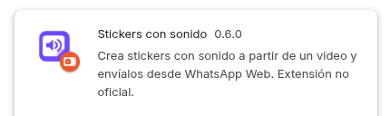

<h1 align="center">Figurinhas com som</h1>

Transforme um vídeo, uma imagem ou um GIF em uma <b>figurinha com som</b> e envie pelo <b>WhatsApp Web</b>. Tudo é processado no seu navegador: nada é enviado para nenhum servidor além do WhatsApp.

 

Gratuito e sem fins lucrativos. As doações são voluntárias.

> **Tradução:** esta é a versão em **português do Brasil** do projeto [Stickers con sonido](https://github.com/Shirtep/WA-audio-stickers), criado por [Shirtep](https://github.com/Shirtep) (original em espanhol). O código e as ideias são do autor original; aqui só foram traduzidos os textos. O botão **Apoiar** leva ao Ko-fi do autor original.

> **Aviso:** projeto pessoal, **não oficial**, sem qualquer relação com o WhatsApp ou a Meta. Usa funções internas do WhatsApp Web que podem mudar a qualquer momento e ativa no seu navegador o recurso de figurinhas com som, que o WhatsApp está testando. Use por sua conta e risco.

## Instalação

Não é preciso executar nenhum programa: você carrega a pasta da extensão no navegador (Chrome, Edge ou Brave para computador). **Não funciona no Firefox** nem em navegadores baseados nele (veja os [Requisitos](#requisitos)).

1. Baixe o [**ZIP da versão mais recente**](https://github.com/git-jr/WA-audio-stickers/releases/latest/download/figurinhas-com-som.zip) (ele também está na página de [versões](https://github.com/git-jr/WA-audio-stickers/releases/latest)).
2. Descompacte em um lugar onde ele vá ficar, por exemplo `Documentos`. Você terá uma pasta `figurinhas-com-som`.
   **Não apague nem mova a pasta depois:** o navegador carrega a extensão a partir dela.
3. Abra a página de extensões: digite `chrome://extensions` na barra de endereços (no Edge, `edge://extensions`).
4. Ative o **Modo do desenvolvedor** (no canto superior direito):

   

5. Clique em **Carregar sem compactação** (em algumas versões chama-se *Carregar extensão descompactada*):

   

6. Escolha a pasta `figurinhas-com-som` do passo 2 e clique em **Selecionar pasta**. A extensão vai aparecer:

   

7. Clique no ícone de peça de quebra-cabeça na barra do navegador e fixe **Figurinhas com som** com o alfinete, para deixar o ícone roxo sempre à mão.

As capturas de tela são do Brave. No Chrome e no Edge é igual, mudando só as cores.

**Atualizar:** baixe o ZIP da nova versão e substitua o conteúdo da pasta `figurinhas-com-som` pelo novo. Depois clique no botão de recarregar (↻) da extensão na página de extensões. Suas configurações são mantidas.

**Desinstalar:** clique em **Remover** na página de extensões e apague a pasta.

## Como usar

1. Abra o [web.whatsapp.com](https://web.whatsapp.com) e entre na conversa para a qual quer enviar a figurinha.
2. Clique no ícone roxo da extensão. O painel tem três abas, cada uma com seu formulário:
   - **Vídeo:** um vídeo com o próprio som (veja os passos abaixo).
   - **Imagem + áudio:** uma imagem fixa com o som que você escolher (MP3, M4A, OGG, WAV ou o som de um vídeo). Você corta o áudio com alças sobre a forma de onda, e a figurinha dura o tempo desse trecho.
   - **Vídeo ou GIF + áudio:** uma animação (um vídeo sem o som dele, ou um GIF) com outro áudio. Se as durações forem diferentes, por padrão cada um dura o seu tempo: ao tocar na figurinha, os dois começam juntos e terminam separados. Você também pode repetir a animação ou deixar parado o último quadro até o áudio acabar. Mudar o trecho de áudio não obriga a recalcular as opções.

   Na aba **Vídeo** há quatro passos:
   1. **Vídeo:** escolha um vídeo com som.
   2. **Trecho:** arraste as alças verdes para marcar o início e o fim. O vídeo mostra o quadro exato, e os botões **−/+** movem um quadro por vez.
   3. **Formato:** clique em **Calcular opções**. Aparece uma tabela de resolução × fps com o tamanho estimado de cada combinação:
      - verde: cabe;
      - amarelo: cabe reduzindo a qualidade;
      - ✕: não cabe;
      - ★: a recomendada.
   4. **Criar e enviar:** se quiser, escreva o **pacote** e o **autor** (o WhatsApp os mostra embaixo da figurinha), crie a figurinha, confira a prévia e envie.
3. Pelo celular, você pode marcá-la como favorita para usar de novo.

## Limites

| | Limite | Motivo |
|---|---|---|
| Tamanho da figurinha | **1 MB** | O servidor do WhatsApp rejeita arquivos maiores (erro 413). |
| Tamanho do áudio | 1 MB (≈ 10 min) | Limite do WhatsApp Web para o áudio da figurinha. |
| Resolução | 64 a 512 px | O WhatsApp usa 512 px. Maior que isso não melhora a imagem e aumenta o tamanho. |
| Fluidez | até 30 fps | O WhatsApp só exige que cada quadro dure pelo menos 8 ms. |

Quanto mais longo o trecho, menos resolução ou fps cabem em 1 MB: a tabela do passo 3 mostra o que cabe antes de você criar qualquer coisa.

Quem recebe a figurinha precisa de uma versão do WhatsApp que já reproduza figurinhas com som. Se não tiver, em vez da figurinha vai aparecer o aviso *«Você recebeu uma mensagem que não é compatível com a sua versão do WhatsApp»* e será preciso atualizar o WhatsApp para vê-la.

## Privacidade

- A conversão do vídeo acontece no seu navegador.
- A extensão guarda um **registro de diagnóstico** apenas no seu navegador, com os números de telefone ocultos e sem senhas ou chaves. Você pode vê-lo, baixá-lo ou apagá-lo em *Ferramentas de teste*, no painel, ou clicando com o botão direito no ícone → *Opções*.

## Requisitos

- Chrome, Edge ou Brave para computador, atualizado (usa WebCodecs para codificar o áudio). Outros navegadores baseados em Chromium, como Opera ou Vivaldi, provavelmente funcionam, mas não foram testados.
- Uma conta do WhatsApp aberta no WhatsApp Web.

**Não funciona no Firefox** nem nos navegadores baseados nele (LibreWolf, Waterfox, Floorp, Zen, Tor Browser…): eles usam outro sistema de extensões e não conseguem carregá-la. Também não funciona no Safari nem em navegadores de celular.

## Não está funcionando?

Confira isto antes de reportar; resolve a maioria dos casos:

1. **Ao carregar, o navegador diz que o manifesto (`manifest.json`) está ausente:** você escolheu a pasta errada. Alguns descompactadores criam uma pasta dentro de outra: escolha a que contém diretamente o `manifest.json`.
2. **A extensão aparece com erro ou sumiu:** você moveu ou apagou a pasta depois de instalar. Coloque-a de volta onde estava, ou remova a extensão e carregue de novo.
3. **Você clica no ícone e nada acontece:** recarregue a aba do WhatsApp Web (F5). As abas abertas antes de instalar ou atualizar a extensão não a têm.
4. **O navegador está desatualizado:** atualize-o (no Chrome: menu ⋮ → Ajuda → Sobre o Google Chrome) e tente de novo.
5. **Quem recebeu vê «Você recebeu uma mensagem que não é compatível com a sua versão do WhatsApp»:** a figurinha foi enviada corretamente, mas o WhatsApp da pessoa ainda não reproduz figurinhas com som. Ela precisa atualizar o WhatsApp pela loja de aplicativos do celular. Não é um problema da extensão.
6. **Você está com uma versão antiga da extensão:** [baixe a mais recente](https://github.com/git-jr/WA-audio-stickers/releases/latest/download/figurinhas-com-som.zip) e atualize (veja *Atualizar* na instalação).

Se nada disso resolver, pode ser que o seu WhatsApp Web seja diferente: o WhatsApp não entrega a mesma versão para todo mundo ao mesmo tempo, e a extensão usa partes internas que podem mudar. Nesse caso, reporte como explicado abaixo, com o registro de diagnóstico.

## Reportar um problema ou sugerir algo

Os reportes e sugestões são recebidos em [**Issues**](https://github.com/git-jr/WA-audio-stickers/issues/new/choose). Você precisa de uma conta do GitHub (é grátis). Clique em **New issue** e escolha:

- **Problema:** algo falha ao instalar ou ao usar.
- **Sugestão:** uma ideia ou melhoria.

Antes, procure nos [issues existentes](https://github.com/git-jr/WA-audio-stickers/issues?q=is%3Aissue) para ver se alguém já reportou: se sim, comente lá em vez de abrir outro.

Para um **problema**, inclua:

- Seu navegador e a versão dele, e seu sistema (Windows, macOS, Linux).
- A versão da extensão (aparece no topo do painel).
- O que você fez, o que esperava e o que aconteceu. Uma captura de tela ajuda muito; cubra as conversas e os números que aparecerem.
- **O registro de diagnóstico**, se o problema acontece ao usar a extensão:
  1. Abra o painel, expanda **Ferramentas de teste** no final e clique em **Diagnóstico**.
  2. Repita o que falhou.
  3. Clique em **Salvar registro…** e anexe o arquivo `.json` ao issue (arraste-o para a caixa de texto). Se o GitHub não aceitar, compacte-o em um ZIP.

  O registro oculta os números de telefone e não inclui mensagens nem senhas, mas inclui os nomes dos arquivos que você escolheu e o nome da conversa para a qual você enviou a figurinha. Abra-o em um editor de texto e apague ou altere o que não quiser compartilhar antes de anexar.

Se o problema é na instalação, não precisa do registro: basta uma captura de tela da mensagem de erro da página de extensões.

Problemas de funcionamento que não tenham a ver com a tradução também podem ser reportados no [projeto original](https://github.com/Shirtep/WA-audio-stickers/issues) (em espanhol).

## Para desenvolvedores

- [`docs/como-funciona.md`](docs/como-funciona.md): como uma figurinha com som é montada (protobuf, formato do áudio, limites) e como a extensão funciona.
- [`dev/`](dev/): páginas para testar a conversão sem o WhatsApp e o vídeo de calibração de sincronia.

## Licença

Uso livre e gratuito, **sem fins comerciais**: você pode usar, estudar, modificar e compartilhar, mas não vender nem usar para obter lucro. Texto completo em [`LICENSE.md`](LICENSE.md) ([PolyForm Noncommercial 1.0.0](https://polyformproject.org/licenses/noncommercial/1.0.0)). Oferecido como está, sem garantias.
